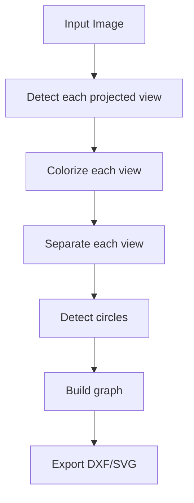

# img-to-dxf-ai

This project converts an image of a mechanical drawing into a DXF file.

## Installation

```bash
git clone https://github.com/your-username/img-to-dxf-ai.git
cd img-to-dxf-ai
uv sync
cp .env.example .env
# edit .env
```

## Usage

This script can generate a DXF file or an SVG file from an image.

```bash
uv run python scripts/make_outline.py <input_image_path>
```

## Dependencies

- Object detection
  - Gemini 2.5 pro
- Image Segmentation (Using either of the following models)
  - Nanobanana Pro
  - GPT Image
  - Reve

## Architecture


